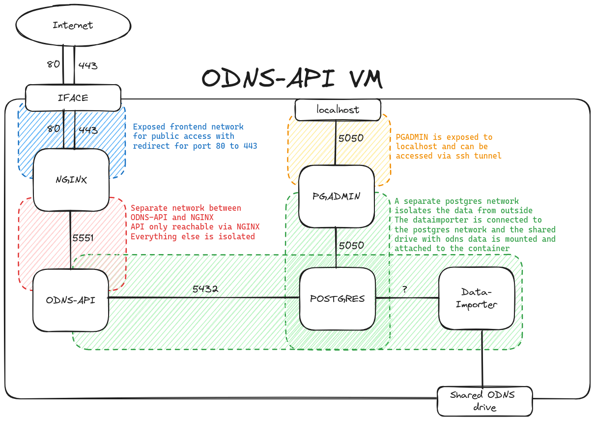

# ODNS-API Full Stack Deployment
This repository contains the full deployment stack for the ODNS-API.
This repository contains submodules (!), use

`git clone --recursive https://github.com/netd-tud/odns-api-full-stack.git`

to also clone the submodules, otherwise it won't work without further steps.

## Network Structure


## Setup
1. Clone repository
2. Rename `.env.template` into `.env` and adjust connection values
3. Rename `config.ini.template` into `config.ini` and adjust connection values
4. Run `./start-all.sh`

### Production Use
`./start-all.sh` includes the `web` (Nginx) and `certbot` services. The domain
`odns-data.netd.cs.tu-dresden.de` must point to this host, with ports 80 and 443
reachable from the internet. Nginx serves the ACME challenge over HTTP and
loads the certificate when Certbot issues or renews it.

- On an existing host, back up the full `CERTIFICATE_DIR` (default
  `/etc/letsencrypt`) and keep it mounted so the stack can reuse the existing
  certificate and renewal state. Free ports 80 and 443 from any host web server
  before starting the services. Pause host renewal for this certificate during
  the cutover, and retire it once container renewal succeeds. Check the existing
  renewal configuration for any hooks that depend on host commands.
- On a fresh host, set `CERTBOT_EMAIL` in `.env` to register with Let's Encrypt.
  Keep port 80 reachable for future renewals. HTTPS becomes available after
  the first certificate has been issued.

To start Nginx and Certbot with their API and database dependencies:

```sh
docker compose -f docker-compose.yml -f docker-compose.db.yml \
  -f docker-compose.api.yml -f docker-compose.web.yml up -d web certbot
```

Test renewal against Let's Encrypt staging once a certificate is available:

```sh
docker compose -f docker-compose.yml -f docker-compose.db.yml \
  -f docker-compose.api.yml -f docker-compose.web.yml exec certbot \
  certbot renew --dry-run --cert-name odns-data.netd.cs.tu-dresden.de \
  --webroot --webroot-path /var/www/certbot --webroot-map '{}' --no-directory-hooks
```

## Teardown
There is a teardown script which you can run with

`./teardown.sh`

which also removes the postgres volume/data completely -- so be careful.
Removing that volume is necessary when adding new scripts to `postgres-init/` 
These scripts will only run once on database creation as they are mounted to `docker-entrypoint-initdb.d/`

## Latest Dataset Downloads

The importer publishes the latest TCP and UDP scans as CSV, CSV compressed with
Zstandard, and Parquet. Downloads require an API key and are available through:

`GET /api/v2/ODNSQuery/DownloadLatest?protocol=tcp&format=csv.zst`

Valid protocols are `tcp` and `udp`; valid formats are `csv`, `csv.zst`, and
`parquet`. The API authorizes the request and nginx serves the published file
from its internal download location.

### Updating an Existing Database

Postgres initialization scripts do not run again for an existing data volume.
Apply the updated query function and the idempotent indexes before deploying the
new API:

```sh
docker compose -f docker-compose.yml -f docker-compose.db.yml exec -T postgres_db sh -c 'psql -U "$POSTGRES_USER" -d "$POSTGRES_DB" -f /docker-entrypoint-initdb.d/02-create-get-dns-entries-function.sql'
docker compose -f docker-compose.yml -f docker-compose.db.yml exec -T postgres_db sh -c 'psql -U "$POSTGRES_USER" -d "$POSTGRES_DB" -f /docker-entrypoint-initdb.d/05-create-performance-indexes.sql'
```

## ToDo List
- [ ] Makefile integration
- [ ] Healthchecks for .Net app
- [ ] ?
